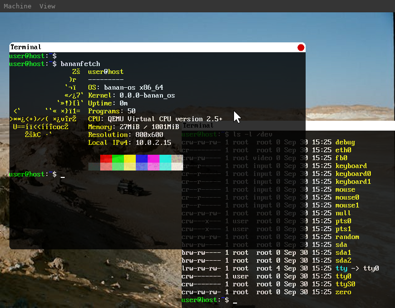

[](https://git.bananymous.com/Bananymous/banan-os)
[](https://git.bananymous.com/Bananymous/banan-os)
[](https://git.bananymous.com/Bananymous/banan-os/src/branch/main/LICENSE)
[](https://discord.gg/ehjGySwYdK)

# banan-os

This is my hobby operating system written in C++. Currently supports x86\_64 and i686 architectures.

You can find a live demo [here](https://bananymous.com/banan-os)



### Features

#### General
- [x] Ring3 userspace
- [x] SMP (multiprocessing)
- [x] Linear framebuffer (VESA and GOP)
- [x] Network stack
- [x] USB stack
- [x] Audio support
- [x] ELF executable loading
- [x] AML interpreter (partial)
- [x] Basic graphical environment
  - [x] Terminal emulator
  - [x] Status bar
  - [x] Program launcher
  - [ ] Some nice apps
- [x] ELF dynamic linking
- [x] copy-on-write memory

#### Drivers
- [x] NVMe disks
- [x] ATA (IDE, SATA) disks
- [x] E1000 and E1000E NICs
- [x] RTL8111/8168/8211/8411 NICs
- [x] AC97 and iHDA audio cards
- [x] PS2 keyboard and mouse
- [x] USB
  - [x] xHCI
  - [ ] EHCI
  - [ ] OHCI
  - [ ] UHCI
  - [x] Keyboard
  - [x] Mouse
  - [x] Mass storage
  - [x] Hubs
  - [ ] Network
  - [ ] Audio
- [ ] virtio devices (network, storage)

#### Network
- [x] ARP
- [x] ICMP
- [x] IPv4
- [x] UDP
- [x] TCP
- [x] Unix domain sockets
- [ ] SSL

#### Filesystems
- [x] Virtual filesystem
- [x] Ext2
- [x] FAT12/16/32
- [x] Dev
- [x] Ram
- [x] Proc
- [ ] 9P

#### Bootloader support
- [x] GRUB
- [x] Custom BIOS bootloader
- [ ] Custom UEFI bootloader

## Code structure

Each major component and library has its own subdirectory (kernel, userspace, libc, ...). Each directory contains directory *include*, which has **all** of the header files of the component. Every header is included by its absolute path.

## Building

### Needed packages

#### apt (tested on ubuntu 22.04)
```# apt install build-essential git ninja-build texinfo bison flex libgmp-dev libmpfr-dev libmpc-dev parted qemu-system-x86 cpu-checker```

#### pacman
```# pacman -S --needed base-devel git wget cmake ninja parted qemu-system-x86```


### Compilation

To build the toolchain for this os. You can run the following command.
> ***NOTE:*** The following step has to be done only once. This might take a long time since we are compiling binutils and gcc.
```sh
./bos toolchain
```

To build the os itself you can run one of the following commands.
```sh
./bos qemu
./bos qemu-nographic
./bos qemu-debug
./bos bochs
```

You can also build the kernel or disk image without running it:
```sh
./bos kernel
./bos image
```

To build for other architectures set environment variable BANAN\_ARCH=*arch* (e.g. BANAN\_ARCH=i686).

To change the bootloader you can set environment variable BANAN\_BOOTLOADER; supported values are BANAN (my custom bootloader) and GRUB. The build system will ask for sudo password when installing GRUB.

To run with UEFI set environment variable BANAN\_UEFI\_BOOT=1. You will also have to set OVMF\_PATH to the correct OVMF (default */usr/share/ovmf/x64/OVMF.fd*).

To build an image with no physical root filesystem, but an initrd set environment variable BANAN\_INITRD=1. This can be used when testing on hardware with unsupported USB controller. If BANAN\_INITRD is set to a value larger than 1, initrd will be gzip compressed.

If you have corrupted your disk image or want to create new one, you can either manually delete *build/banan-os.img* and build system will automatically create you a new one or you can run the following command.
```sh
./bos image-full
```

To test on real hardware, I have a script to generate a compressed ISO. The ISO can be copied directly to an USB drive with for example `dd`. The file is created at build/banan-os.iso and can be generated with
```sh
./bos iso
```

I have also created shell completion script for zsh. You can either copy the file in _script/shell-completion/zsh/\_bos_ to _/usr/share/zsh/site-functions/_ or add the _script/shell-completion/zsh_ to your fpath in _.zshrc_.

### Package Manager

banan-os uses xbps as its package manager for ports. All upstream ports are packaged into xbps packages hosted on a [repository on my server](https://packages.bananymous.com/banan-os). You can manage sysroot's xbps packages with `./bos` wrapper. You can use `xbps-install`, `xbps-remove` and `xbps-query` with repository and sysroot set to the correct values. For example to install xbps that can be used inside banan-os you can use
```sh
./bos xbps-install -S xbps
```
For xbps usage see [their documentation](https://docs.voidlinux.org/xbps/index.html).


## Contributing

As the upstream is hosted on my server https://git.bananymous.com/Bananymous/banan-os, merging contributions is not as trivial as it would be on GitHub. You can still send PRs in GitHub in which case I should be able to download the diff and apply it manually. If you want, I can also provide you an account to my git server. In this case please contact me ([email](mailto:oskari.alaranta@bananymous.com), [discord](https://discord.gg/ehjGySwYdK)).

As this is mostly a learning experience for me, I would appreciate if you first contacted me about adding new features (email, discord, issue, ...). If you send a PR about something I was planning on doing myself and you didn't ask me, I will probably just close it. Bug fixes are always welcome!

Commit message should be formatted followingly

  1. First line is of the form "_Subject: Description_", where _Subject_ tells the area touched (Kernel, Shell, BuildSystem, ...) and _Description_ is brief description of the change done. First line should fit fully in 72 characters.
  2. Body of the message should further describe the change and reasoning behind the change.

All commits should pass the pre-commit hook defined in _.pre-commit-config.yaml_. For instructions on how to setup pre-commit, please see https://pre-commit.com/#install.
